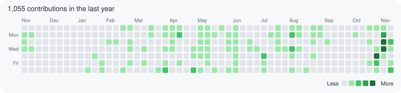

  
  
  
  
  
  
  

 

demo: [sentiment-sleuth on hugging face spaces](https://huggingface.co/spaces/elsayedelmandoh/sentiment-sleuth)

<picture>
  <source media="(prefers-color-scheme: dark)" srcset="assets/generated/contrib_dark.svg">
  
</picture>

<picture>
  <source media="(prefers-color-scheme: dark)" srcset="assets/generated/snake-dark.svg">
  
</picture>

repos: [Arabic_Abstractive_Summarization](https://github.com/elsayedelmandoh/Arabic_Abstractive_Summarization) · [detect-terrorists](https://github.com/elsayedelmandoh/detect-terrorists)

  
  
  
  
  
  
  

plain-text version

### about

nlp/llm engineer with 2+ years of production ml: rag pipelines and end-to-end nlp systems. m.sc. in ai & data science (a+) at queen's university, canada.

thesis: minimallm, verbosity-aware decoding for llms (sponsored by deloitte). a training-free logits processor cut output tokens 25-35% on mistral-7b, llama-3.1-8b and qwen2.5-3b. an audit showed it was learned early stopping, so i built an entailment-licensed sentence-elision method that beats matched-length truncation.

languages: arabic, english, russian (basics). off-keyboard: chess, gym, reading about 5gw/6gw warfare.

### experience

- **data scientist**, administrative capital for urban development, new capital, egypt (oct - nov 2026): smart-city iot/gis data cleaning and integration (python, sql/duckdb), documented quality checks with pii masking (law 151/2020), kpi pipeline with variance and root-cause analysis. built the ai component of spaceeye-geoai: inspection-file agent with verification log, complaints classifier, dashboard search/filters/map click, chatbot integration (python, streamlit, fastapi, duckdb, chromadb, gemini, scikit-learn, google earth engine data).
- **digilians program**, egyptian military academy / mcit, new capital, egypt (sep 2025 - present): selected from 40k+ applicants to enroll in the m.sc. at queen's university. workshops with deloitte (pre-training vs fine-tuning, rag architectures, passive chatbots to active ai agents, etl/elt for genai, mlops lifecycle), ibm (resume building, networking, star interviews) and dotpy (startup fundamentals, freelancing); sessions at cairo ict (cyshield) on ai agents and at edex on ai in drones, air defense and defense systems.
- **head of artificial intelligence**, international modern school sayed galal, cairo, egypt (oct 2024 - jun 2025): joined as ai teacher (oct - nov 2024), then head of ai (dec 2024 - jun 2025) leading ai curriculum development and the ai teaching team. taught python and ai to years 5-8 and grades 7-10 across american and british curricula; trained 25 students in 5 teams for the british council code club competition; ran internal competitions for the code challenge championship (scratch, python, ai).
- **machine learning engineer**, electro pi, new cairo, egypt (aug 2023 - aug 2025): designed and shipped 15+ production ml systems (harmful-prompt detector for llms, customer-service chatbot, code-quality evaluator, medical image analysis, automated eda, automated ml); semantic search engine (tf-idf, lsi, labse) at 87% map; sentiment pipeline (naive bayes + lstm, nltk) at 93% test accuracy; zero-code automl and autoeda platforms; completed 11 specialization tracks (python, eda, ml, dl, cv, nlp, llms, rag, prompt engineering, langchain).
- **ai instructor**, huawei ict academy, egypt (dec 2022 - feb 2023): hcia, python & machine learning for 30 students; authored session plans, assignments and labs. before that, ai intern (oct - nov 2022): completed huawei's hcia course and explored huawei's ai services and tools.

### education

- **m.sc. artificial intelligence & data science (a+)**, queen's university, kingston, canada (jan - nov 2026): thesis on minimallm, verbosity-aware decoding for llms; supervisor dr. rahatara ferdousi; sponsor deloitte (mentor collaboration bridging academic llm research with enterprise ai deployment).
- **aspire leaders program**, harvard university (apr - aug 2024).
- **b.sc. artificial intelligence**, egyptian russian university (eru), cairo (oct 2020 - jul 2024): studied ml, dl, nlp, cv; russian language 1 & 2 (a+ in both); represented eru in ai competitions at auc, nile university, military technical college and air defense college. graduation project linkedup: academic networking platform for the egyptian education sector connecting students, teachers and universities with relevant jobs via recommendations (python, django, rest apis, ml, cosine similarity).

### certifications

- aws certified cloud practitioner (aws)
- aws academy graduate: machine learning for natural language processing (aws academy)
- aws machine learning foundations (aws)
- aws academy cloud foundations (aws academy)
- machine learning specialization (stanford / deeplearning.ai): supervised machine learning: regression and classification; advanced learning algorithms; unsupervised learning, recommenders, reinforcement learning
- tools of the trade: linux and sql (google)
- introduction to data engineering (ibm)
- python for data science, ai & development (ibm)
- langchain (electro pi)
- natural language processing (electro pi)
- computer vision (electro pi & kaggle)

### competitions

- arabic abstractive summarization @ icmtc-23 (military technical college): fine-tuned mt5, rouge r1 0.10 / r2 0.02 / rl 0.08 ([repo](https://github.com/elsayedelmandoh/Arabic_Abstractive_Summarization))
- terrorist detection @ itc-23 (air defense college): yolov8x + autodistill, civilian/military classification and weapon detection, 0.738 map50 / 0.637 map50-95 ([repo](https://github.com/elsayedelmandoh/detect-terrorists))
- also participated: medgenius - 16th ugrf competition, su real life competition, itc-egypt adc competition, artificial intelligence competition (aic), egyptian startup olympics

