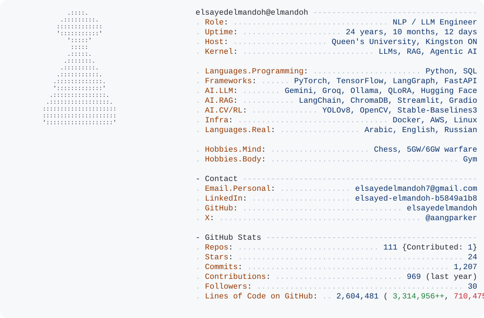

  <a href="https://github.com/elsayedelmandoh">
    <picture>
      <source media="(prefers-color-scheme: dark)" srcset="dark_mode.svg">
      
    </picture>
  </a>

  

  
  <!-- TODO confirm X handle -->
  
  

---

### about me

nlp/llm engineer with 2+ years of production ml: rag pipelines and end-to-end nlp systems. m.sc. in ai & data science (a+) from queen's university, canada.

thesis: minimallm, verbosity-aware decoding for llms (sponsored by deloitte). a training-free logits processor cut output tokens 25-35% on mistral-7b, llama-3.1-8b and qwen2.5-3b; an audit showed it was learned early stopping, so i built an entailment-licensed sentence-elision method that beats matched-length truncation.

languages: arabic, english, russian (basics)

off-keyboard: chess, gym, and reading about 5gw/6gw warfares.

### tech stack

  
  
  
  
  
  

  
  
  
  
  
  

  
  
  
  

  
  
  
  

everything i use

- **language:** python
- **ml/dl:** pytorch, tensorflow, keras, scikit-learn
- **nlp & llms:** hugging face, langchain, langgraph, spacy, nltk, gensim, rag, prompt engineering
- **cv:** opencv, yolov8
- **tools:** docker, git, linux, aws, terraform, fastapi, streamlit, gradio
- **databases:** mysql, sqlite, chromadb, duckdb

### featured projects

| project                                                                                                                                               | what it does                                                                                                                                                       | stack                                       |
| ----------------------------------------------------------------------------------------------------------------------------------------------------- | ------------------------------------------------------------------------------------------------------------------------------------------------------------------ | ------------------------------------------- |
| [spaceeye-geoai](https://github.com/elsayedelmandoh/spaceeye-geoai)                                                                                    | ranks 12 coded R7 compounds for an inspection committee from free satellite data (earth engine). three clocks (k2/k3/k6), streamlit dashboard + hybrid rag chatbot | chromadb, duckdb, gemini, arabic-nlp        |
| [russ-rag-based-tutor-for-specific-subjects-genai-queens](https://github.com/elsayedelmandoh/russ-rag-based-tutor-for-specific-subjects-genai-queens)  | private offline rag tutor over course pdfs. citation-backed answers, zero cloud leakage                                                                            | langchain, chromadb, hf embeddings          |
| [multimodal-chatbot](https://github.com/elsayedelmandoh/multimodal-chatbot) · [demo](https://huggingface.co/spaces/elsayedelmandoh/multimodal-chatbot) | text + image chatbot                                                                                                                                               | gemini api, gradio                          |
| [web-search](https://github.com/elsayedelmandoh/web-search)                                                                                            | gradio app: google search + gemini for grounded, cited answers                                                                                                     | python, gradio, gemini                      |
| [instructor-for-agentic-ai](https://github.com/elsayedelmandoh/instructor-for-agentic-ai)                                                              | groq api + gradio agent that teaches agentic ai                                                                                                                    | python, groq, gradio                        |
| [sentiment-sleuth](https://github.com/elsayedelmandoh/sentiment-sleuth) · [demo](https://huggingface.co/spaces/elsayedelmandoh/sentiment-sleuth)       | traditional ml sentiment pipeline, sgd champion: acc 0.8903, f1 0.8902                                                                                             | sgd, tf-idf, nltk, scikit-learn             |
| [atari-rl-benchmarking](https://github.com/elsayedelmandoh/atari-rl-benchmarking)                                                                      | dqn, ppo, discrete sac on atari (pong, breakout, space invaders)                                                                                                   | pytorch, gymnasium, sb3, custom discretesac |
| [lightweight-speech-emotion-recognition-on-open-datasets](https://github.com/elsayedelmandoh/lightweight-speech-emotion-recognition-on-open-datasets)  | 6-class ser on ravdess: 1d cnn on log-mel (~150k params, <1ms cpu inference) vs mfcc+svm                                                                           | pytorch, specaugment, librosa               |
| [detect-terrorists](https://github.com/elsayedelmandoh/detect-terrorists)                                                                              | air defense college competition detector: 0.738 map50, 0.637 map50-95                                                                                              | yolov8x, autodistill                        |
| [GemiLla](https://github.com/elsayedelmandoh/GemiLla)                                                                                                  | dual-agent orchestration with gemini + groq/llama-3 (may 2024)                                                                                                     | streamlit, gemini, groq                     |

earlier work @ electro pi

| project                                                                                                                                              | what it does                                         |
| ---------------------------------------------------------------------------------------------------------------------------------------------------- | ---------------------------------------------------- |
| [automated_ml](https://github.com/elsayedelmandoh/automated_ml)                                                                                       | zero-code automl platform                            |
| [automated_eda](https://github.com/elsayedelmandoh/automated_eda)                                                                                     | automated eda platform                               |
| [lsi-labse-semantic-search-widebot](https://github.com/elsayedelmandoh/LSI-LaBSE-semantic-search-widebot)                                             | semantic search with tf-idf / lsi / labse, 87% map   |
| [naive-bayes-lstm-for-sentiment-analysis-nlp-widebot](https://github.com/elsayedelmandoh/naive-bayes-LSTM-for-sentiment-analysis-NLP-widebot)         | sentiment pipeline, naive bayes + lstm, 93% test acc |
| [evaluating-language-models-for-harmful-prompt-detection](https://github.com/elsayedelmandoh/evaluating-language-models-for-harmful-prompt-detection) | harmful-prompt detection for llms                    |
| [medical-image-analysis-with-vgg16-resnet-cnn](https://github.com/elsayedelmandoh/Medical-Image-Analysis-with-VGG16-ResNet-CNN)                       | medical image analysis with vgg16 / resnet           |

### competitions

- **[arabic abstractive summarization](https://github.com/elsayedelmandoh/Arabic_Abstractive_Summarization)** @ icmtc-23: fine-tuned mt5. rouge r1 0.10 / r2 0.02 / rl 0.08.
- **terrorist detection** @ itc-23: yolov8x. 0.738 map50.

### education & experience

- **m.sc. ai & data science** (a+), queen's university, kingston: jan-nov 2026. thesis: minimallm (supervisor dr. rahatara ferdousi, sponsor deloitte)
- **digilians program**, egyptian military academy / mcit: sep 2025-present. selected from 40k+ applicants for the queen's m.sc.; workshops with deloitte, ibm, dotpy; sessions at cairo ict and edex
- **data scientist**, administrative capital for urban development: oct-nov 2026. smart-city iot/gis data cleaning (python, sql/duckdb), pii masking, kpi pipeline; built the spaceeye-geoai ai component (inspection-file agent, complaints classifier, chatbot integration)

earlier

- **ml engineer**, electro pi: aug 2023-aug 2025. 15+ production ml systems (harmful-prompt detector for llms, customer-service chatbot, code-quality evaluator, medical image analysis, automated eda, automl)
- **ai instructor**, huawei ict academy: dec 2023-feb 2024. python & ml (hcia) to 30 students
- **b.sc. ai**, egyptian russian university: oct 2020-jul 2024. graduation project linkedup, an academic networking platform (python, django, rest, cosine-similarity recommendations). represented eru in ai competitions at auc, nile university, military technical college and air defense college

### stats

  <picture><source media="(prefers-color-scheme: dark)" srcset="https://github-readme-streak-stats.herokuapp.com/?user=elsayedelmandoh&theme=tokyonight&hide_border=true"></picture>

  <picture><source media="(prefers-color-scheme: dark)" srcset="https://github-profile-summary-cards.vercel.app/api/cards/most-commit-language?username=elsayedelmandoh&theme=github_dark"></picture>
  <picture><source media="(prefers-color-scheme: dark)" srcset="https://github-profile-summary-cards.vercel.app/api/cards/repos-per-language?username=elsayedelmandoh&theme=github_dark"></picture>

### connect

[linkedin](https://linkedin.com/in/elsayed-elmandoh-b5849a1b8/) · [email](mailto:elsayedelmandoh7@gmail.com) · [x](https://x.com/aangparker)

---

  

  <i>if you made it this far, you should probably just follow me tbh</i>

